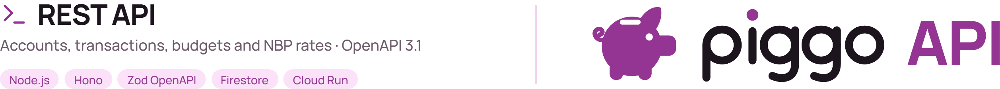
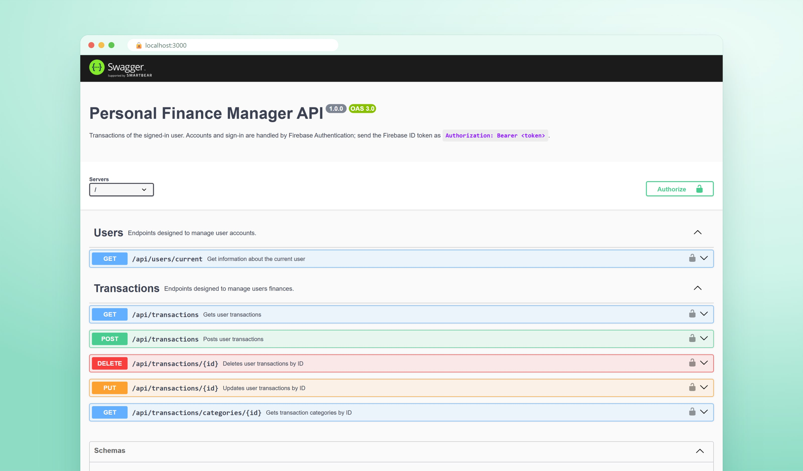
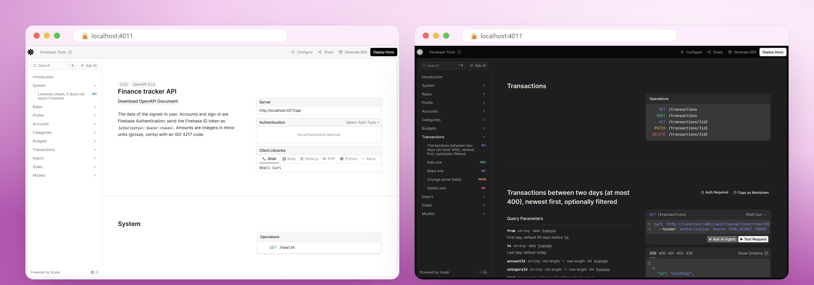

<p align="center">
  <picture>
    <source media="(prefers-color-scheme: dark)" srcset="docs/images/banner-dark.png">
    
  </picture>
</p>

<p align="center">
  
</p>

## About

**finance-tracker-api** is the REST API of the finance tracker, version 2 of the personal finance app: the signed-in
user's profile now, and accounts, categories, transactions, budgets and currency rates as the work goes on. It runs on
Google Cloud Run, signs users in with Firebase Authentication and keeps the data in Firestore. The web app is
[`finance-tracker`](https://github.com/DamTchorzewski/finance-tracker); its plan is
[docs/redesign-plan.md](https://github.com/DamTchorzewski/finance-tracker/blob/develop/docs/redesign-plan.md) there.

- **Contract first.** Every route is declared with a Zod schema (`@hono/zod-openapi`); the OpenAPI 3.1 document is
  generated from them, served at `/api/openapi.json` with an interactive reference at `/api/docs`, and committed as
  `openapi.json`, from which the web app generates its typed client.
- **Signed in on every request.** The Firebase ID token in `Authorization: Bearer` is verified on each call; an
  unconfirmed e-mail address is refused (`REQUIRE_VERIFIED_EMAIL`).
- **One error shape.** `{ "error": { "code", "message", "issues"? } }`, with one issue per wrong field on a 400.
- **Guard rails.** A per-user rate limit (`RATE_LIMIT_PER_MINUTE`), a 256 kB body limit, security headers,
  `Cache-Control: private, no-store` on every answer, CORS off unless `CORS_ORIGIN` lists an origin.
- **Profile.** `GET /api/me` and `PATCH /api/me/profile`: base currency, language, the day the budget month starts,
  theme, accent hue, privacy mode and the order of the dashboard widgets.
- **Accounts with exact balances.** Cash, bank, savings, card and foreign-currency accounts; each write of a
  transaction moves the `flowMinor` of the accounts it touches in the same Firestore transaction, so a balance is
  always the opening balance plus the transactions.
- **Transactions.** Expenses, income and transfers (also between currencies: the received amount is converted at the
  rate of the day unless it is given); a note, payee and tags; listed by date range (up to 400 days) with filters and
  text search. The value in PLN is frozen at the rate of the transaction's day, so old reports never change.
- **Categories and budgets.** A new user gets 17 categories in their language (each with a `key` the app can
  translate); own ones with a Lucide icon and a palette colour; one monthly budget per expense category, with alert
  thresholds and rollover. Anything in use is archived, not deleted.
- **Import from version 1.** `POST /api/import/v1` copies the old `users/{uid}/transactions` once into a new PLN
  account, mapping the old English categories; version 1 is only read.
- **Currency rates.** `GET /api/rates` (mid rates of a day, NBP table A), `/api/rates/cash` (bank buy and sell,
  table C), `/api/rates/history` (one currency, up to 366 days) and `/api/rates/convert`. NBP first, retried once
  (it answers a passing 500 now and then), then the ECB rates through Frankfurter; a weekend or a holiday gets the
  last table before it. Past days are kept in Firestore for good, today for 30 minutes; the answers are public and
  cached by Firebase Hosting's CDN, so the demo uses them without an account.
- **Money in minor units.** `src/lib/money.ts` rounds on the decimal digits (1.005 PLN is 101 grosze) and converts
  through the PLN mid rates; the minor digits of each currency come from Node's ICU data.
- **Its own data.** Version 2 writes under `apps/finance-tracker/users/{uid}` in Firestore, apart from version 1, so
  the old app keeps working with the same sign-in accounts.

> **Status:** live (2026-11-25) behind [piggo-finance.web.app](https://piggo-finance.web.app). Done: the foundations, the profile, the currency rates, accounts,
> categories, transactions, budgets and the import from version 1. Next: recurring transactions, goals and rules
> (release 2 of the plan). Version 1 of this API is
> [`personal-finance-manager-api`](https://github.com/DamTchorzewski/personal-finance-manager-api), from which this
> repository was copied with its history.

## Tech stack

|          |                                                                                    |
| -------- | ---------------------------------------------------------------------------------- |
| Stack    | Node.js 22.18+ running TypeScript directly (type stripping, no build step), Hono 4 |
| Contract | Zod 4, `@hono/zod-openapi` (OpenAPI 3.1), Scalar API reference                     |
| Auth     | Firebase Authentication, ID tokens verified with Firebase Admin                    |
| Data     | Cloud Firestore (Firebase Admin)                                                   |
| Tests    | Vitest against the app with a fake token verifier and an in-memory store           |
| Hosting  | Google Cloud Run (europe-west1, min 0 / max 2 instances), built from the source    |

Code, comments, commits and the README are in English; `docs/` is in Polish (the owner reads it).

## Screenshots

<p align="center">
  
</p>

The reference is the Scalar page the API serves at `/api/docs`; the terminal shows real answers of a local server (a
public currency conversion and the error for a call without a token). No database and no account were used.

## Quick start

```bash
git clone https://github.com/DamTchorzewski/finance-tracker-api.git
cd finance-tracker-api
pnpm install
cp .env.example .env   # FIREBASE_PROJECT_ID and GOOGLE_APPLICATION_CREDENTIALS, or the emulator hosts
pnpm dev               # http://localhost:8080/api/health, docs at /api/docs
```

Requirements: Node.js 22.18 or newer (`.nvmrc`: 22) and pnpm 11.18 (`packageManager`).

## Scripts

| Command                        | Does                                                                      |
| ------------------------------ | ------------------------------------------------------------------------- |
| `pnpm dev`                     | the API with reload on change, reading `.env`                             |
| `pnpm start`                   | the API as Cloud Run starts it                                            |
| `pnpm check`                   | `format:check`, `lint`, `typecheck` and `test`: run before a pull request |
| `pnpm test`                    | unit tests (Vitest)                                                       |
| `pnpm openapi`                 | writes `openapi.json`; `--check` fails when it is out of date (CI)        |
| `pnpm health`                  | read-only check of a live API (`API_URL`)                                 |
| `pnpm format`, `pnpm lint:fix` | fix formatting and lint                                                   |

## Configuration

All variables, names only, are in [`.env.example`](.env.example); the defaults are in `src/env.ts`. None is a secret.

| Variable                 | What it does                                                          |
| ------------------------ | --------------------------------------------------------------------- |
| `FIREBASE_PROJECT_ID`    | the Firebase / Google Cloud project; set on Cloud Run by the deploy   |
| `CORS_ORIGIN`            | origins allowed from another origin (local web app); empty = CORS off |
| `REQUIRE_VERIFIED_EMAIL` | `false` lets in users with an unconfirmed e-mail address              |
| `RATE_LIMIT_PER_MINUTE`  | requests per user and minute, default 120                             |

## Structure

```
src/
  server.ts            starts the API with Firebase Admin (Cloud Run, local)
  app.ts             ★ the app: middleware, routes, the OpenAPI document
  env.ts               settings read from the environment
  lib/                 errors, sign-in middleware, rate limit, money and dates
  ledger/              the rules across documents: seeding, checks, the frozen PLN value, the import
  rates/               NBP and ECB clients, the rates service and its Firestore cache
  routes/            ★ one file per resource (system, me, rates, ledger)
  schemas/           ★ Zod schemas, the contract
  store/               storage interface; Firestore and in-memory implementations
  test/                test helpers (fake token verifier)
scripts/               write-openapi.ts, health-check.ts
openapi.json           the generated contract (committed)
docs/                  deployment and repository settings
```

## Branches and workflows

Shared standards from `reops/standards`: `main` ≤ `develop` ≤ a working branch `<type>/<topic>`, Conventional Commits in
English, `git.md` and `workflows.md`. `ci.yml` checks every pull request; `deploy.yml` runs CI on `develop` and `main`
and deploys `main` to Cloud Run with a health check; `weekly.yml` checks the live API every Monday.

**Departures from the standards (and why):**

- **No build step:** Node.js runs the TypeScript files itself (type stripping), so `build` is not a script; Cloud Run
  starts `pnpm start`.
- **No end-to-end tests:** an API without a browser; the routes are tested through the app in `pnpm test`
  (memory store) and in `pnpm test:emulator` (the Firestore emulator, run by CI; it needs Java 21).
- **No phone strip and no "Open site" button:** an API has no page for a phone and no site of its own; the images show
  its own reference page and a terminal.

## Documentation

| File                                     | What it covers                                                          |
| ---------------------------------------- | ----------------------------------------------------------------------- |
| [docs/deployment.md](docs/deployment.md) | Google Cloud, Firebase and GitHub setup for version 2, the first deploy |
| [docs/repository.md](docs/repository.md) | GitHub description and topics, and the command that sets them           |

The README images (`docs/images/`) are made with `tools/readme-images`, profile `finance-tracker-api`, from a local
server; the working shots go to `.scratch/`.

## Versions

| Version             | Repository                                                                                       | Made by                                                 |
| ------------------- | ------------------------------------------------------------------------------------------------ | ------------------------------------------------------- |
| 1                   | [`personal-finance-manager-api`](https://github.com/DamTchorzewski/personal-finance-manager-api) | [Damian Tchorzewski](https://github.com/DamTchorzewski) |
| 2 (this repository) | `finance-tracker-api`                                                                            | [Damian Tchorzewski](https://github.com/DamTchorzewski) |

Licensed under the [MIT License](LICENSE).

---

<p align="center"><a href="https://damreboot.pl"><picture><source media="(prefers-color-scheme: dark)" srcset="docs/images/damreboot/company-dark.svg"></picture></a><a href="https://www.linkedin.com/in/damian-tchorzewski-3b2388275/"><picture><source media="(prefers-color-scheme: dark)" srcset="docs/images/damreboot/linkedin-dark.svg"></picture></a><a href="mailto:damianchabracki@gmail.com"><picture><source media="(prefers-color-scheme: dark)" srcset="docs/images/damreboot/email-dark.svg"></picture></a></p>

<p align="center">
  <picture><source media="(prefers-color-scheme: dark)" srcset="docs/images/damreboot/engineered-dark.svg"></picture> Engineered by <b>Damian Chabracki</b> (DamReboot IT)
</p>
